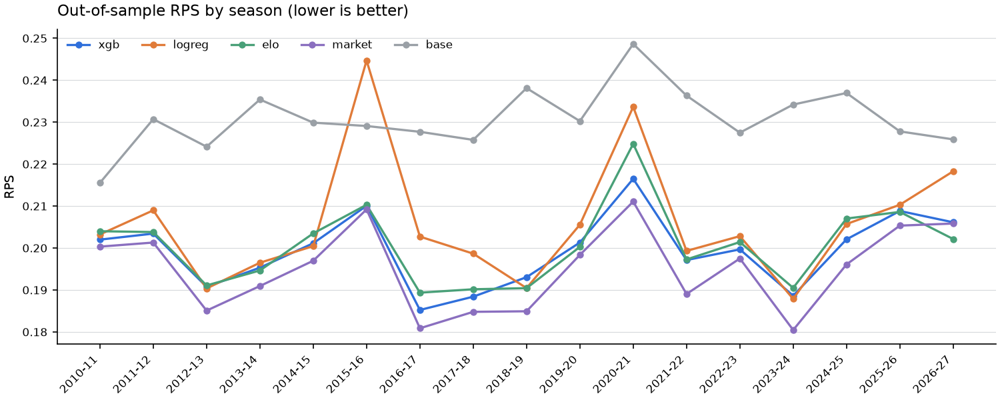
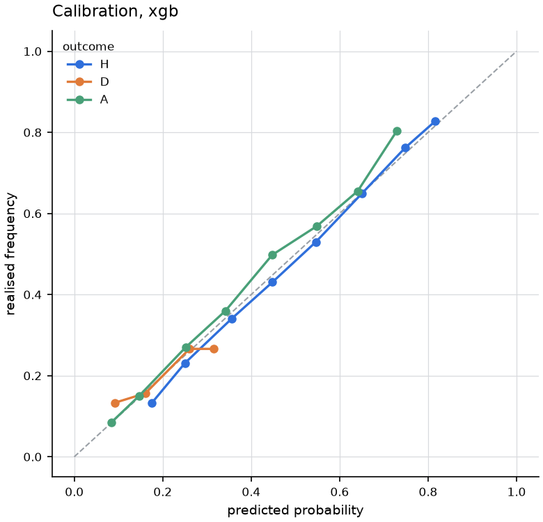

# Premier League Match Outcome Predictor

Predicts **home win / draw / away win** probabilities for Premier League
fixtures. Trained on 27 seasons (2000-01 to 2026-27, 9,940 matches) from
football-data.co.uk, with Understat expected-goals and line-up data from
2014-15, and evaluated with a strict walk-forward backtest over the last 17
seasons.

The honest headline: **the model reaches 53.6% accuracy out-of-sample, against
54.4% for the bookmakers' closing odds and 44.7% for always picking the home
side.** It beats the naive baseline comfortably and the bookmakers not at all.

---

## Results

Walk-forward, 2010-11 → 2026-27, 6,140 matches. Each season is predicted by a
model trained only on matches that finished before that season started.

| model | what it is | accuracy | log loss | RPS ↓ | Brier ↓ |
|---|---|---|---|---|---|
| `market` | bookmakers' closing odds, de-vigged | **54.4%** | **0.962** | **0.1946** | **0.5699** |
| `xgb` | gradient-boosted trees, 130 features | 53.6% | 0.977 | 0.1990 | 0.5802 |
| `elo` | logistic regression on Elo difference alone | 53.3% | 0.981 | 0.2005 | 0.5827 |
| `logreg` | multinomial logistic regression, same features | 51.6% | 1.011 | 0.2052 | 0.5988 |
| `base` | historical H/D/A base rate, every match | 44.7% | 1.069 | 0.2311 | 0.6462 |

**RPS** (ranked probability score) is the headline metric. It is the standard
scoring rule for football because it respects the ordering of outcomes:
predicting a draw when the home side wins is penalised less than predicting an
away win. Accuracy alone is a poor guide here — see "Why accuracy misleads".

### What the numbers say

**Gradient boosting buys very little over a plain Elo rating.** XGBoost with 130
engineered features scores RPS 0.1990; a logistic regression on the single Elo
difference scores 0.2005. Roughly 95% of the achievable signal is "which team
is better, and who is at home". The shots, corners, rest days, head-to-head
record, expected goals, squad availability and Poisson strength ratios
collectively move the needle by about 0.7%.

**The bookmakers are not beatable with this data.** The market wins on every
metric and in all 17 seasons tested, without exception. Blending the model into the market makes the
market *worse* (RPS 0.1958 vs 0.1946), which means the model carries no
information the closing price has not already absorbed. Even handing the model
the market's own implied probabilities as input features only gets it to
0.1969 — still short of just using the odds directly.

**Accuracy does not improve as a season progresses.** Tracking 2025-26 week by
week, cumulative accuracy drifts from ~55% early to 48.4% by matchweek 38, and
cumulative RPS is flat-to-slightly-worse. Form features are essentially
saturated by matchweek 6; after that, extra matches add noise as much as
signal. Season-to-season variation (RPS 0.185 in 2016-17 vs 0.217 in 2020-21)
dwarfs any within-season trend.

**2020-21 was the hardest season for every model**, including the bookmakers —
the crowdless COVID season, where home advantage partly evaporated.

It does not translate into money either: betting the model's probabilities
returns -3.87% at closing odds, worse than staking at random. There is a
section on that below.

**Three attempts were made to close the gap**, and the pattern is consistent:
better football data barely moved anything, while market data moved a lot.
Expected goals bought 2.6% of the gap, squad availability bought nothing, and
watching the betting odds drift during the week bought 16% — seven times xG's
effect, in all 10 seasons tested. The one signal that works is the one that is
not really a prediction. Each has its own section below.



### Calibration

Probabilities are close to honest: in the bucket where the model says 75% home
win, the home side wins 75% of the time. Two mild biases remain — home win
probabilities run ~1.5pp hot, away win probabilities run ~2-5pp cold.



### Does expected goals close the gap?

No. This was the most promising lever left, so it got a clean test.

Understat publishes match-level xG back to 2014-15. Adding 37 xG-derived
features — rolling xG for and against, non-penalty xG, finishing
over/under-performance, PPDA (pressing intensity), deep completions, and a
second Poisson model driven by xG instead of goals — and re-running the
backtest on the 3,480 matches from 2017-18 onward where every model sees the
same rows:

| model | accuracy | log loss | RPS ↓ |
|---|---|---|---|
| `market` | 54.8% | 0.9550 | **0.19437** |
| `xgb` **with** xG | 54.0% | 0.9738 | 0.19975 |
| `xgb` **without** xG | 53.7% | 0.9744 | 0.19985 |
| `elo` | 53.5% | 0.9772 | 0.20119 |

The improvement is **real in direction but negligible in size**. xG wins in
9 of 10 seasons (sign test p = 0.021) and on a paired Wilcoxon test over
individual matches (p = 0.039), so it helps slightly more often than it hurts.
But the mean RPS gain is 0.00010 with a 95% confidence interval of
[-0.00038, +0.00059] — a paired t-test gives p = 0.68. In accuracy terms it is
**10 extra correct matches out of 3,480**, and it closes **2.6% of the gap to
the bookmakers**.

The interesting part is that the model clearly *wants* the data. Train on the
xG era alone, where the columns are never missing, and 7 of the 15
highest-gain features are xG-derived — `exp_xg_diff` ranks third and the
xG-Poisson home probability fourth, both above every shot-based feature:

```
elo_diff                     38.6
elo_exp_home                 35.6
exp_xg_diff                  23.7     <- xG
xgpois_p_h                   20.0     <- xG
xgpois_p_a                   12.2     <- xG
diff_venue_form12_xg_for     10.0     <- xG
diff_venue_form12_shots_for   9.7
diff_form10_deep_for          7.6     <- xG
```

So xG is heavily used and barely helps. The explanation is redundancy: xG
measures roughly what the Elo rating and the shots-on-target features already
capture between them — how good a team is and how good its chances were. It is
a cleaner measurement of the same underlying thing, not new information.

One caveat worth recording: **xG makes the linear baseline worse**, dropping
`logreg` from 52.9% to 51.6%. Because xG is missing for every match before
2014-15, median-imputing it injects noise across 53% of the training window.
Trees can branch on "missing" as a category; a linear model cannot. Run
`backtest --no-xg` to reproduce the pre-xG numbers.

### Does team-sheet information close the gap?

Also no — and this one is not even close.

No free historical injury feed covers the Premier League at match level. What
is available is who actually took the field: Understat lists every player who
appeared in each match from 2014-15, with minutes, position and xG
contribution. From **past line-ups only**, five availability features are
derived per team — how much of the squad's recent minutes and attacking
contribution belongs to players who have missed the last one or two matches,
how many regular starters are among them, and how much the XI was rotated.
Lagging the signal this way keeps it usable days before kick-off, like every
other feature here.

On the same 3,480 matches, added on top of xG:

| model | accuracy | log loss | RPS ↓ | gap to market |
|---|---|---|---|---|
| `market` | 54.8% | 0.9550 | **0.19437** | — |
| `xgb` + xG + availability | 54.0% | 0.9738 | 0.19962 | +0.00525 |
| `xgb` + xG | 54.0% | 0.9738 | 0.19975 | +0.00537 |
| `xgb` plain | 53.7% | 0.9744 | 0.19985 | +0.00547 |

The availability features are **indistinguishable from noise**. RPS improves by
0.00012 (95% CI [-0.00026, +0.00050], paired t p = 0.53, Wilcoxon p = 0.89),
accuracy goes *down* by two matches, and they help in 5 of 10 seasons — a coin
flip. For comparison, xG at least won 9 of 10 seasons. Together, xG and
availability close about 4% of the gap to the bookmakers.

The model's own ranking agrees. Trained where both are always present, xG
features take three of the top five places by gain, while the best
availability feature ranks **40th**:

```
elo_exp_home                 35.7
elo_diff                     35.3
exp_xg_diff                  22.9     <- xG
xgpois_p_a                   20.6     <- xG
xgpois_p_h                   18.2     <- xG
...
diff_absent_xgchain_share_2   4.1     <- best availability feature, rank 40
```

**What this does and does not show.** It does not show that injuries are
irrelevant to football results — they obviously matter. It shows that a
*lagged proxy* for them, built from who played recently, carries almost no
information the model does not already have. A player's absence shows up in
his team's recent results, and the form and Elo features have already priced
that in. The thing the bookmakers have and this model cannot get for free is
**team news in the hour before kick-off** — the confirmed line-up, the
late fitness test. That is a different and much sharper signal than "he missed
the last two games", and it is the most likely remaining explanation for the
gap.

Because the scrape costs ~4,600 requests against a free site and buys nothing
measurable, it is **opt-in**: `fetch --with-squads`. Without it the pipeline
runs normally and the availability columns stay empty.

### Does odds movement close the gap?

Partly — and it is the only one of the three that clearly works. But it works
by borrowing the market's homework rather than by predicting anything.

football-data publishes an early price and a closing price from the same
bookmaker, with full coverage from 2012-13 (Pinnacle, then Bet365). The
difference between them is where the week's money went: the market revising
its own opinion. That is a different kind of signal from everything else
here — information about what other people know, not about the teams.

Three questions, same 3,480 matches:

**1. Does the drift help a model that cannot see the price?** Yes, clearly.

| model | accuracy | log loss | RPS ↓ | gap to market |
|---|---|---|---|---|
| `market` (closing odds) | 54.8% | 0.9550 | **0.19437** | — |
| `xgb` + all market features | 54.6% | 0.9641 | 0.19637 | +0.00176 (64% closed) |
| `xgb` + drift only | 54.0% | 0.9717 | 0.19876 | +0.00404 (16% closed) |
| `xgb` (no market data) | 54.0% | 0.9738 | 0.19962 | +0.00483 |

Adding only the drift features — never the price level — improves RPS by
0.00086, in **10 of 10 seasons**, with paired t p = 0.005 and Wilcoxon
p = 0.035. That is roughly **seven times the effect of xG**, and the first
addition in this project to pass a paired t-test. It closes 16% of the gap to
the bookmakers. Give the model the price levels too and it closes 64% — but at
that point it is mostly reading the market's answer off the board.

**2. Is the closing price efficient with respect to its own drift?** Yes.

Fitting a multinomial logistic regression on the closing probabilities *plus*
the drift gives RPS 0.19468 against 0.19437 for the closing price alone —
very slightly worse, with p = 0.43 and a confidence interval straddling zero.
Knowing how the price moved tells you nothing the closing price has not
already absorbed. This is the textbook efficient-market result, and it is the
reason the model cannot be pushed past the bookmakers this way.

**3. How much does the week's money actually improve the price?**

Opening odds score RPS 0.19553, closing odds 0.19437 — an improvement of
0.00115 with p = 1.1e-4. The market genuinely learns during the week. The
model picks up about three quarters of that learning (0.00086 of 0.00115)
just by watching the drift.

**These features are off by default.** The point of the project is a predictor
built from football data and benchmarked against the market; a model that
reads the market is not an independent forecast, and it still loses to the
closing price. They live behind `--use-odds`, and the headline table at the
top of this README is odds-free.

### Would betting it make money?

No. At realistic prices the model loses roughly the bookmaker's margin, and
its bet selection is **worse than no selection at all**.

A bet is placed whenever the model's probability beats the price, meaning
`p_model x price > 1`. Note the comparison is against `1/price` — the
*vigged* implied probability — not the de-vigged one. Comparing against
de-vigged probabilities is the standard way to manufacture a fake edge on
nearly every match, since those sum to 1 and quietly ignore the margin.

Flat stakes, 15 seasons, out-of-sample predictions only:

| model | price | bets | ROI | 95% CI | t |
|---|---|---|---|---|---|
| *(stake everything)* | closing | 16,140 | **-3.29%** | -4.82 .. -1.71 | -4.12 |
| `xgb` | closing | 7,289 | **-3.87%** | -7.85 .. +0.46 | -1.85 |
| `xgb`, edge > 5% | closing | 5,483 | -4.25% | -9.30 .. +0.78 | -1.63 |
| `elo` | closing | 6,952 | -6.16% | -10.24 .. -2.15 | -3.05 |
| `market` | closing | **0** | — | — | — |

Three things in that table matter more than the headline number.

**The model's selection destroys value rather than creating it.** Staking
every outcome of every match loses 3.29%, which is just the margin. Betting
only where the model sees value loses 3.87% — *more*. The matches it picks
out as mispriced are, if anything, the ones it understands worst.

**Raising the threshold makes it worse, which is the signature of a spurious
edge.** A real edge concentrates when you demand more of it. This one dilutes:
0% -> -3.87%, 5% -> -4.25%. Compare the genuine edge below, which doubles.

**The market model finds zero bets.** De-vigged closing probabilities never
beat the price they came from, at any threshold. That is the check that the
harness is not inventing edges.

#### The harness does find a real edge, where one exists

Betting the *closing* probabilities into the *opening* price returns **+5.83%**
(t = 2.33, CI +0.97 .. +10.79), rising to **+15.52%** at a 5% threshold
(t = 3.06, CI +5.63 .. +25.88) — concentrating exactly as a real edge should.

This is closing line value: the closing price is sharper than the opening
price, which is the same fact that showed up earlier as opening odds scoring
RPS 0.19553 against 0.19437 for closing. **It is not a strategy** — it
requires knowing Saturday's closing price before placing a bet at Monday's
opening price. It is here because a betting backtest that cannot detect a
known, real edge is not evidence of anything, and this one can.

#### Best available prices are not a fair test

Taking the best price across all bookmakers gives an overround of **0.9954** —
below 1, meaning the book itself is theoretically arbitrageable. Staking
everything blindly at those prices returns **+1.02%**. The model returns
**-0.35%**: still worse than betting at random, in a scenario that hands out
free money. Any "profitable system" demonstrated at max odds should be read
with this in mind.

#### Season variance

Even the losing strategy swings wildly — +22.2% in the partial 2026-27, -17.6%
in 2023-24, profitable in 4 of 15 seasons. A handful of seasons is nowhere
near enough to tell a 3% edge from a 3% loss, which is why the confidence
intervals above are as wide as they are.

```
python -m epl.cli bet --scenarios close open best_close --thresholds 0 0.05
```

### Why accuracy misleads

The model picks a draw in just 16 of 6,140 matches, and is right 6 times.
That is correct behaviour, not a bug: draws happen 24.3% of the time but are
almost never the *most likely single outcome*, so a well-calibrated model
rarely makes them the argmax. A model tuned to maximise accuracy would simply never predict
draws either. This is why RPS and log loss, which score the whole probability
vector, are the metrics to watch.

```
confusion (xgb)   predicted
actual          H     D     A
     H       2325     5   413
     D       1051     6   435
     A        937     5   963
```

---

## Website

A static page of the current week's predictions, the model's running record and
the backtest charts is published to GitHub Pages:

**https://slzyyy.github.io/epl-match-predictor**

Build it locally:

```bash
python -m epl.cli site      # writes site/index.html
open site/index.html
```

`.github/workflows/site.yml` rebuilds and republishes it every Tuesday at
06:00 UTC (and on every push to `main`), running the tests, refetching data,
re-running the backtest and regenerating the page. Nothing is served
dynamically: predictions only change when fixtures and results change, so
there is nothing for a server to compute per visitor.

The page leads with the fact that the model loses to the bookmakers and that
betting it returns -3.87%. That is deliberate — a page of confident-looking
percentages with no context is an invitation to bet on them.

If the data source is unreachable the build falls back to the last cached copy
rather than failing, and fixtures that have already kicked off are filtered
out, so a stale feed cannot put finished matches on the page.

## Install

Requires Python 3.11+. On macOS, XGBoost also needs the OpenMP runtime
(`brew install libomp`).

```bash
uv venv .venv && uv pip install --python .venv/bin/python -e ".[dev]"
```

## Use

```bash
# download 27 seasons and build the feature table (~10s)
python -m epl.cli fetch

# optional: also scrape per-match line-ups (~25 min, no measurable gain)
python -m epl.cli fetch --with-squads

# walk-forward backtest, all models, writes charts + CSVs to reports/
python -m epl.cli backtest

# how accuracy evolved through one season
python -m epl.cli track --season 2025-26

# probabilities for the next week of fixtures
python -m epl.cli predict --days 7

# what the model is actually using
python -m epl.cli importance --top 20

# value-betting backtest: ROI, confidence intervals, no-skill control
python -m epl.cli bet --scenarios close open best_close

# build the static site into site/
python -m epl.cli site
```

Sample output from `predict`:

```
      date     home_team      away_team  p_home  p_draw  p_away pick  confidence
Sat 17 Oct      Man City        Ipswich    77.9    12.9     9.2    H        77.9
Sun 18 Oct Nott'm Forest        Arsenal    26.9    24.2    48.9    A        48.9
Sun 18 Oct         Leeds     Man United    31.7    28.2    40.1    A        40.1
```

Useful flags: `--no-xg` and `--no-avail` ablate the two add-on feature sets,
`--use-odds` lets the model see bookmaker implied probabilities,
`--feature-set full` switches from the 78-column core set to all 214,
`--refit-days 30` refits mid-season, `--main-model logreg` swaps the estimator.

---

## Data

[football-data.co.uk](https://www.football-data.co.uk/englandm.php) — one CSV
per season, no API key. Chosen over the Kaggle datasets because it needs no
authentication, extends back to 2000-01 with consistent columns, updates within
a day of each matchday, and ships closing odds from several bookmakers, which
is what makes the market benchmark above possible.

Each season gives full-time result, half-time result, shots, shots on target,
corners, fouls, cards and odds. Two quirks in the archive are handled in
`data.py`: some seasons are latin-1 rather than UTF-8, and some rows carry
extra trailing commas (2003-04 has 45 such rows, which a strict CSV parser
drops silently — that is 12% of the season).

Both an early price and a closing price are extracted where a single
bookmaker published both — Pinnacle from 2012-13, Bet365 and the market
average from 2019-20, giving 5,380 matches with full open/close coverage. The
pair always comes from one firm, so the drift is never one bookmaker's opening
price against another's close.

Fixtures for the coming week come from the same site's `fixtures.csv`.

**Expected goals** come from [Understat](https://understat.com/league/EPL),
which covers the Premier League from 2014-15 — 4,620 matches, joined with 100%
coverage on season plus the two team names (unique within a season, so a
rescheduled fixture cannot break the join). Understat serves the same JSON its
league pages render, at `/getLeagueData/EPL/<year>`; `xg.py` caches each season
and pauses between requests.

FBref was tried first and is behind a Cloudflare challenge that returns 403 to
scripted requests. That block was left alone rather than worked around.

## Features

130 features in the default `core` set, all strictly pre-match (78 of them
available for every season, the other 52 from 2014-15 onward, and the 15
availability features only when line-ups have been scraped):

- **Elo rating** — updated in date order with a goal-margin multiplier, a 65-point
  home advantage, carried across seasons with regression to the mean, and a
  promoted-side discount for teams entering the league.
- **Rolling form** over the last 3 / 5 / 10 matches: points, wins, goals for and
  against, shots, shots on target, corners, cards, clean sheets.
- **Venue-specific form** over the last 6 / 12 home-only or away-only matches.
- **Season to date** — points, goals, goal difference, and the per-match versions.
- **Poisson strength** — attack and defence multipliers against the trailing
  league average, the expected goals they imply, and the H/D/A probabilities
  from an independent Poisson scoreline grid.
- **Expected goals** (2014-15 onward) — rolling xG and xG conceded over 3 / 5 / 10
  matches and over the last 12 at the same venue, non-penalty xG, finishing
  over/under-performance (goals minus xG, which regresses), PPDA, deep
  completions, and a second Poisson model driven by xG rather than goals.
- **Squad availability** (opt-in, 2014-15 onward) — share of the squad's recent
  minutes and xG contribution belonging to players who have missed the last
  one or two matches, how many regular starters that covers, and how much the
  XI was rotated.
- **Market** (off by default, `--use-odds`) — de-vigged opening and closing
  probabilities, the drift between them, total drift magnitude, and how much
  bookmaker margin came out of the price during the week.
- **Scheduling** — days of rest, matches played in the last 14 days.
- **Context** — head-to-head record, league experience (a promoted-side proxy),
  matchweek.

The model is given home/away **differences** for each of these, which is where
most of the signal lives. Gain-ranked over full history the top features are
the Elo difference, the goals-Poisson home probability and the season
goal-difference gap; restricted to the xG era, xG features take four of the
top six places (see the xG section above).

`--no-xg` and `--no-avail` ablate the Understat feature sets, `--use-odds`
enables the market features, and `--feature-set full` switches from the
130-column core set to all 354.

## Avoiding leakage

A match-outcome model is easy to make look good by accident — one post-match
column left in the feature matrix and accuracy jumps into the 90s. Three
mechanisms guard against it, each with a test:

1. **Every rolling statistic is shifted by one match within each team**, so a
   match never sees its own result. `test_form_feature_matches_hand_computation`
   recomputes a rolling feature by hand and compares.
2. **Rewriting the future cannot change the past.**
   `test_shuffling_future_results_does_not_change_past_features` replaces every
   result after match 40 with a 9-0 home win and asserts the first 40 rows'
   features are bit-identical.
3. **The backtest never trains on the future.**
   `test_walk_forward_never_trains_on_the_future` checks the recorded training
   size equals the count of matches strictly before each test block's first
   kick-off.

Raw match statistics (shots, corners, cards, goals, odds and the match's own
xG) are excluded from the feature matrix by name in `features.LEAKY_COLS`,
with tests asserting the set is empty of them. The future-rewriting test is
run a second time against the xG columns specifically, since those arrive
through a separate join and could otherwise sidestep the main guard.

Unplayed fixtures get the same treatment in reverse: they flow through the
pipeline to pick up pre-match features but contribute no results to anything.
Rolling windows are computed over played matches only and carried forward, so
two upcoming fixtures for the same team both see the state after their last
*played* match rather than each other's blanks.

```bash
python -m pytest     # 50 tests
```

## What moved the needle, and what did not

Recorded so none of it is retried blindly. The only clear win is odds drift,
and it is disabled by default for the reason given in its section.

**Worked:**

- **Bookmaker odds drift** (`--use-odds`). RPS 0.19962 -> 0.19876, better in
  10 of 10 seasons, paired t p = 0.005. Closes 16% of the gap to the closing
  price; the full market feature set closes 64%. Does not beat the closing
  price, and is not an independent forecast.

**Did not:**

- **Value betting on the model's probabilities.** -3.87% ROI at closing prices,
  worse than no selection at all, and worse still as the edge threshold rises.
  Full write-up above.

- **Recency weighting.** Exponentially down-weighting old matches to correct the
  home-win bias: best half-life (8 seasons) moved RPS 0.19924 → 0.19905 over
  6,140 matches and left the bias at +1.4pp. Within noise. Kept as the opt-in
  `half_life` argument, default off.
- **Mid-season refitting.** Refitting every 30 days instead of once per season:
  RPS 0.19933 vs 0.19929, at six times the compute.
- **The full 214-feature set.** Identical to the 78-column core set to four
  decimal places (0.19929 both), so core is the default.
- **Ensembling.** Averaging xgb + elo + logreg gives RPS 0.19893 vs 0.19924 —
  a 0.16% gain, not worth a third model in the serving path.
- **Feeding the model the market's odds.** RPS 0.1969, still worse than using
  the odds alone (0.1946).
- **Expected goals.** Consistent in direction (better in 9 of 10 seasons) but
  worth 10 extra correct matches in 3,480 and 2.6% of the gap to the
  bookmakers. Kept on by default since it does not hurt the main model, and
  ablatable with `--no-xg`. Full write-up above.
- **Squad availability from past line-ups.** Flat: Wilcoxon p = 0.89, better in
  5 of 10 seasons, accuracy two matches worse, best feature ranked 40th. Made
  opt-in (`fetch --with-squads`, `backtest --no-avail`) rather than removed,
  since the negative result is worth keeping reproducible. Full write-up above.

## Known limits

- **No confirmed team news.** Line-up-derived availability was tried and did
  nothing (see above). What is missing is the *announced* XI and late fitness
  news in the hour before kick-off, which the closing price reflects and no
  free historical feed provides. Backtesting it would also need line-ups
  timestamped at announcement, not at full time.
- **Availability features reset each season**, so the first three matchweeks of
  every season have none — a squad after a transfer window is genuinely a
  different squad, but it does leave a gap.
- **xG covers only 2014-15 onward**, so 53% of the training window has it
  missing. Trees handle that; the linear baseline does not.
- **Promoted teams are weakly modelled** — they enter at a flat Elo discount,
  with no information from their Championship form.
- **Draws are never the argmax**, so accuracy understates the model's usefulness
  as a probability forecaster.
- **Not a betting system.** Measured directly: -3.87% ROI at closing odds over
  7,289 bets, worse than the -3.29% from staking blindly. See the betting
  section.

## Layout

```
src/epl/
  config.py     paths, season range, label encoding
  data.py       download + normalise football-data.co.uk CSVs
  xg.py         Understat expected-goals download and join
  lineups.py    Understat per-match line-ups and squad-availability features
  features.py   feature engineering (leakage-safe)
  model.py      xgb / logreg / elo / market / base estimators
  metrics.py    accuracy, log loss, RPS, Brier, calibration
  evaluate.py   walk-forward backtest, per-season summaries, tracking
  predict.py    fit on everything, score upcoming fixtures
  betting.py    value-betting backtest, staking rules and ROI statistics
  report.py     charts
  site.py       static site generator
  cli.py        command line entry point
tests/          50 tests, leakage-focused
reports/        charts and CSVs written by the CLI
```
